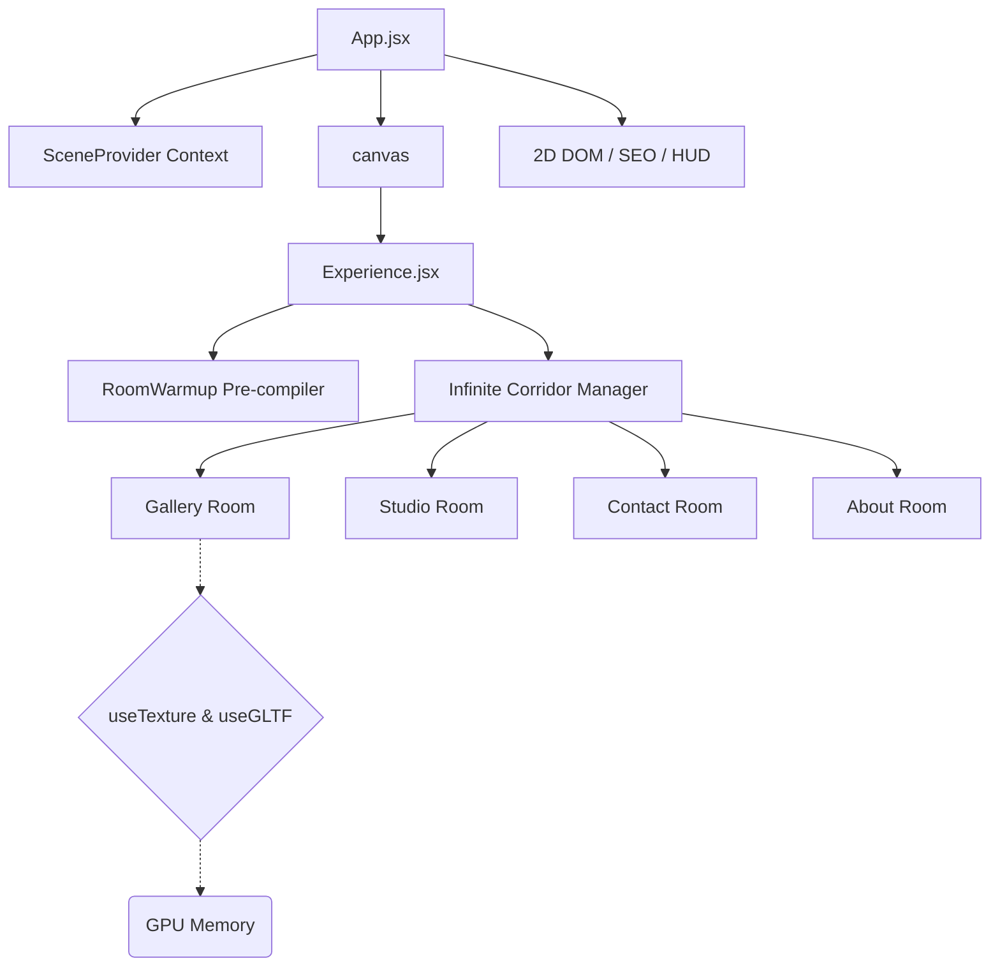

# 🎨 Syed Rayyan | Interactive 3D WebGL Portfolio

<div align="center">
  
  
  
  
  
</div>

<br/>

Syed Rayyan’s software engineering portfolio uses a hand-drawn 3D corridor to connect projects, education, contributions and contact details. The lightweight link page is available at `/start`.

## Updating the portfolio

| Content | File |
| --- | --- |
| Name, initials, headline, summary, contact details and profile URLs | `src/config/profile.js` |
| Gallery projects, education, skills and leadership | `src/config/portfolioContent.js` |
| Studio contributions | `src/components/canvas/rooms/Studio/contentData.js` |
| Standalone link page, including its profile links | `public/start/index.html` |
| Project card art | `public/textures/gallery/project-01.webp`, `project-02.webp`, `project-03.webp` and their `_painted.webp` counterparts |
| Avatar art | `public/textures/entrance/avatar_window.webp`, `public/textures/corridor/avatar_sketch.webp`, and the frames in `public/textures/corridor/avatar_anim/` |
| Résumé, social preview and favicon | `public/resume.pdf`, `public/og-image.webp` and `public/favico.png` |

Copy the settings you need from `.env.example` to `.env`. Set `VITE_WEB3FORMS_KEY` to the public access key associated with the intended recipient. Direct email uses the address in the profile. Set `VITE_SITE_URL` to the published origin when building for production.

Local content works without Sanity. To use a CMS, set `VITE_SANITY_PROJECT_ID` and `VITE_SANITY_DATASET` for the website. Use the corresponding `SANITY_STUDIO_PROJECT_ID` and `SANITY_STUDIO_DATASET` in the optional `sanity-studio` project.

> [!NOTE]
> Ensure hardware acceleration is enabled in your browser settings to experience the smooth 60 FPS high-tier rendering of this application.

## 🚀 Key Performance Architectures (2026 Standards)

This application is strictly optimized for cross-device operability, achieving zero lag spikes even on mobile processors through several bespoke architectural implementations:

1. **Invisible Semantic SEO Fallback:** Bypasses WebGL canvas SEO limitations via strategic `sr-only-seo` indexing DOM injections, rendering fully visible semantic trees to native search-engine crawlers without mounting heavy bundles.
2. **Asynchronous Shader Compilation:** Enforces `gl.compileAsync` during the Preloading phase inside a hidden `RoomWarmup` Suspense boundary. This allows Three.js to pre-compile complex materials asynchronously without blocking the main React update thread.
3. **Baked Global Tinting & Lighing Extraction:** Replaced real-time WebGL shadow maps and infinite light rays with baked-in global textures (`apply_global_tint.js`), dropping the GPU compute overhead entirely while maintaining visual depth.
4. **DOM Mutation Bypassing:** Critical animation properties (like SVG preloader states tracking 130+ concurrent HTTP texture requests) write directly to the `ref.current.style`, intentionally bypassing React’s `setState` render cycles to conserve CPU.
5. **Adaptive Device Tiering:** Auto-detects `navigator.deviceMemory`, hardware concurrency, and viewport sizes to scale WebGL resolutions (`dpr`), antialiasing algorithms, and texture loading strictness on the fly.

---

## 🏗️ 3D Scene Architecture



---

## 🛠️ Local Development Setup

To run this application natively on your local machine:

1. Open a terminal in this repository.

2. **Install dependencies:**
   Make sure you are on Node.js v20+.
   ```bash
   npm install
   ```

3. **Start the local Dev Server:**
   ```bash
   npm run dev
   ```

> [!IMPORTANT]
> Since this project heavily utilizes `vite-plugin-compression` and hundreds of high-res textures, your initial local load might take a few seconds as the dev-server buffers asset delivery. For performance testing, always run `npm run build && npm run preview`.

## 🤝 Contributing & Feedback

All PRs improving the shader physics, 3D math logic, or component memoization runtimes are welcome. Please refer to our new `.github` Issue and Pull Request templates when submitting!

1. Fork the Project
2. Create your Feature Branch (`git checkout -b feature/AmazingRoom`)

3. Commit your Changes (`git commit -m 'feat: Added realistic liquid simulation to Contact Room'`)
4. Push to the Branch (`git push origin feature/AmazingRoom`)
5. Open a Pull Request


## License

The code in this repository is licensed under the [MIT License](LICENSE). 
**Note:** All personal assets, 3D textures, images, and copywriting are copyright of Tomasz Szmajda and may not be reused or reproduced without explicit permission.
---

*Original portfolio design and development by [Tomasz Szmajda (ITom Dev)](https://itomdev.com).*
# portfolio1
